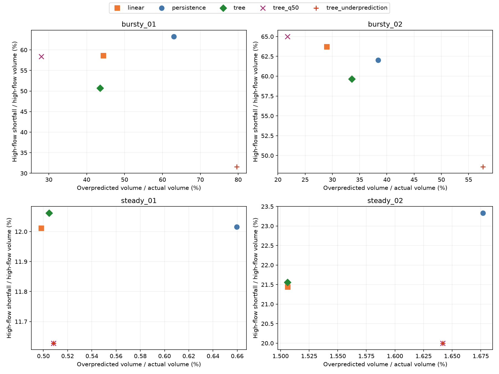
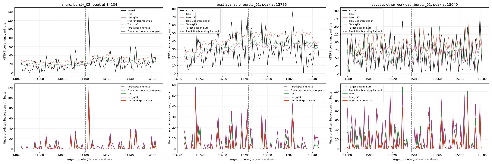

# Part 1 Checkpoint: Forecasting Results and Error Analysis

Date: November 11, 2026. Completed: validation baseline review, controlled training ablation, error diagnostics, plots, and the Part 2/3 forecast handoff. Planned: downstream service/cost comparisons and the final held-out test.

For file schemas, runnable integration examples, replay/scoring bounds, and downstream integration points, use the [Part 2/3 handoff report](part1-delivery.md).

## Question and controlled design

Does a training objective that penalizes underprediction more strongly reduce high-flow errors and consecutive shortfalls, and how much additional overprediction does it produce?

The existing four Azure HTTP applications, chronological 8/3/3-day split, 16 causal features, three-minute decision horizon, clipping, seed 42, and single-thread budget remain fixed. The original tree uses squared-error loss. New variants use the same HistGradientBoostingRegressor and full parameter configuration with only `loss` and `quantile` changed. The leaf limit remains 31 for bursty_01 and 15 for the others; max_iter=100, learning_rate=0.1, min_samples_leaf=20, and early_stopping=false.

Quantile q=0.50 is the symmetric control; q=0.75 gives a 3:1 loss ratio for equal-sized underprediction versus overprediction. Both values were fixed rather than selected from a validation search. Eight new models were fitted on train only. Original baselines were loaded, verified against their saved validation forecasts, and copied into the separate delivery. No original baseline was retrained or replaced.

The complete comparison is ordinary tree versus q=0.75. The q=0.50 versus q=0.75 comparison tests penalty direction within one loss family. Squared-error and median regression have different targets; improvements relative to the original tree alone cannot be attributed exclusively to asymmetry. The public quantile interface is documented in [scikit-learn](https://scikit-learn.org/stable/modules/generated/sklearn.ensemble.HistGradientBoostingRegressor.html).

## Completed validation results

Each application/model has 4,317 target minutes. Counts and MAE/RMSE are in invocations per minute. High flow is `actual > training q95`: thresholds are 8, 4, 95, and 55 for steady_01, steady_02, bursty_01, and bursty_02, respectively.

High-flow shortfall is `sum(max(actual-predicted,0)) / sum(actual)` restricted to those minutes. Overprediction / actual volume is `sum(max(predicted-actual,0)) / sum(actual)` over all scored minutes. Neither fraction is a service violation rate or a server-cost measurement.

| Workload | Model | MAE | RMSE | High-flow shortfall | Overprediction / actual volume |
| --- | --- | --- | --- | --- | --- |
| steady_01 | persistence | 0.1052 | 0.3856 | 12.02% | 0.66% |
| steady_01 | linear | 0.0890 | 0.2742 | 12.01% | 0.50% |
| steady_01 | tree | 0.0944 | 0.2858 | 12.06% | 0.50% |
| steady_01 | tree_q50 | 0.0544 | 0.2752 | 11.63% | 0.51% |
| steady_01 | tree_underprediction | 0.0544 | 0.2752 | 11.63% | 0.51% |
| steady_02 | persistence | 0.1323 | 0.3643 | 23.33% | 1.68% |
| steady_02 | linear | 0.1218 | 0.2462 | 21.44% | 1.51% |
| steady_02 | tree | 0.1186 | 0.2475 | 21.56% | 1.51% |
| steady_02 | tree_q50 | 0.0660 | 0.2569 | 20.00% | 1.64% |
| steady_02 | tree_underprediction | 0.0660 | 0.2569 | 20.00% | 1.64% |
| bursty_01 | persistence | 29.5142 | 42.0314 | 63.24% | 62.99% |
| bursty_01 | linear | 20.4062 | 27.4144 | 58.60% | 44.42% |
| bursty_01 | tree | 19.5710 | 26.6976 | 50.74% | 43.52% |
| bursty_01 | tree_q50 | 18.2185 | 27.3838 | 58.36% | 28.00% |
| bursty_01 | tree_underprediction | 23.8835 | 31.5295 | 31.58% | 79.59% |
| bursty_02 | persistence | 10.6113 | 17.1173 | 62.03% | 38.42% |
| bursty_02 | linear | 8.0823 | 12.5890 | 63.71% | 29.00% |
| bursty_02 | tree | 8.2607 | 12.6994 | 59.64% | 33.57% |
| bursty_02 | tree_q50 | 7.6243 | 12.6657 | 65.00% | 21.78% |
| bursty_02 | tree_underprediction | 10.2197 | 14.6886 | 48.58% | 57.64% |

Source: [complete forecast diagnostics](../outputs/underprediction_ablation_v1/metrics/forecast_diagnostics_validation.csv). The simpler [MAE/RMSE table](../outputs/underprediction_ablation_v1/metrics/forecast_validation.csv) retains the existing downstream schema.

### Separate steady and bursty summaries

Normalize each application's MAE/RMSE by its own training mean, then average applications with equal weights. These are averages of normalized application scores, not pooled RMSE or a cross-scale ranking of raw errors.

| Pattern | Model | Mean normalized MAE | Mean normalized RMSE | Applications |
| --- | --- | --- | --- | --- |
| steady | persistence | 0.0234 | 0.0705 | 2 |
| steady | linear | 0.0211 | 0.0485 | 2 |
| steady | tree | 0.0210 | 0.0494 | 2 |
| steady | tree_q50 | 0.0118 | 0.0499 | 2 |
| steady | tree_underprediction | 0.0118 | 0.0499 | 2 |
| bursty | persistence | 0.9383 | 1.4070 | 2 |
| bursty | linear | 0.6751 | 0.9679 | 2 |
| bursty | tree | 0.6654 | 0.9581 | 2 |
| bursty | tree_q50 | 0.6171 | 0.9701 | 2 |
| bursty | tree_underprediction | 0.8169 | 1.1206 | 2 |

Source: [grouped metrics](../outputs/underprediction_ablation_v1/metrics/forecast_grouped_validation.csv). There are two applications per pattern; the file also records valid denominators and daily results.

### What the ablation shows

- On bursty_01, q=0.75 lowers high-flow shortfall from 50.74% to 31.58% relative to the ordinary tree, a 19.16-percentage-point reduction. Overpredicted volume rises from 44,052.6 to 80,552.6, while MAE increases from 19.5710 to 23.8835.
- On bursty_02, high-flow shortfall falls from 59.64% to 48.58%, an 11.06-percentage-point reduction. Overpredicted volume rises from 20,022.8 to 34,384.2, and MAE increases from 8.2607 to 10.2197.
- The same directional shortfall improvement is present relative to q=0.50 on both bursty applications. The symmetric control itself improves their MAE, but its high-flow shortfalls of 58.36% and 65.00% are worse than the ordinary tree's. A better average-error ranking therefore still does not identify the lowest high-flow shortfall.
- Almost all excess prediction occurs outside high-flow minutes. Relative to the ordinary tree, added non-high-flow overprediction is approximately 36,212.6 for bursty_01 and 14,361.5 for bursty_02. This makes cost matching a necessary downstream comparison.
- On bursty_02, the ordinary, symmetric, and asymmetric trees all miss the threshold in every one of the 115 actual high-flow minutes. The asymmetric model reduces error magnitude without detecting these spikes under the declared threshold rule. On bursty_01, the miss rate does improve, from 86.59% to 68.72%.
- For both steady applications, the symmetric and asymmetric exports are identical. Their lower MAE versus the ordinary tree is a change-of-objective result, with no demonstrated extra benefit from asymmetry. On steady_02, the quantile variants have lower MAE but higher RMSE than the ordinary tree.

Daily paired differences below use candidate minus ordinary tree. Negative shortfall change and positive extra overprediction recur on all three validation days; this supports repeatability within this period, not generalization beyond these applications.

| Workload | Relative day | Shortfall change (percentage points) | Extra overpredicted volume | MAE change |
| --- | --- | --- | --- | --- |
| bursty_01 | 9 | -22.43 | +10,398.3 | +3.2783 |
| bursty_02 | 9 | -12.14 | +4,896.0 | +1.9565 |
| bursty_01 | 10 | -22.01 | +10,773.2 | +3.6996 |
| bursty_02 | 10 | -10.58 | +4,833.3 | +1.9887 |
| bursty_01 | 11 | -17.22 | +15,328.6 | +5.9573 |
| bursty_02 | 11 | -9.89 | +4,632.1 | +1.9319 |

Source: [paired ablation comparisons](../outputs/underprediction_ablation_v1/metrics/ablation_comparison_validation.csv). Fractions in the CSV are unit-interval differences; the table above converts them to percentage points.

### Consecutive errors and small magnitudes

Strict underprediction means `predicted < actual`. Material underprediction requires `actual-predicted >= 1` invocation per minute. Runs break at nonqualifying minutes or gaps.

The ordinary steady_01 tree has a strict run of 193 minutes, but its longest material run is only 5 minutes. The q=0.50 and q=0.75 models have a maximum of 1 minute under both definitions. Bursty_01's longest strict run decreases from 18 to 11 minutes, while its longest material run increases from 10 to 11. Bursty_02 changes from 7 to 6 strict minutes and 6 to 5 material minutes. Thus the candidate does not improve every measure of consecutive errors.

Sources: [strict runs](../outputs/underprediction_ablation_v1/metrics/underprediction_runs_validation.csv), [material runs](../outputs/underprediction_ablation_v1/metrics/material_underprediction_runs_validation.csv), and complete diagnostics. Long strict runs alone are not evidence of a serious service failure.

## Failure, best available comparison, and successful example

Selection uses actual validation counts and ordinary-tree forecasts before modified fitting. The fixed failure is the previously identified largest high-flow rise on bursty_02. The same-application rule first seeks an ordinary peak hit with magnitude within 20% of the failure, then falls back as described in the design receipt.

No ordinary-tree high-flow peak hit exists on bursty_02. The report therefore retains its best available event without calling it successful, and adds an explicitly labeled successful example from the other bursty workload. The supplementary rule prefers matched peak magnitude and lowest event shortfall, with deterministic tie breaking. This is an evidence-driven extension to the original plan, not a change to the training ablation.

| Case | Workload | Target | Actual | Ordinary | q=0.50 | q=0.75 | Available lag_1 | Available diff_1 |
| --- | --- | --- | --- | --- | --- | --- | --- | --- |
| failure | bursty_02 | 14104 | 143 | 21.40 | 20.77 | 28.76 | 19 | 2 |
| best_available | bursty_02 | 13786 | 57 | 52.73 | 39.61 | 54.03 | 70 | 18 |
| success_other_workload | bursty_01 | 15040 | 144 | 141.28 | 99.36 | 145.13 | 80 | 68 |

At each target, `lag_1` and `diff_1` are the values actually available three minutes earlier at the prediction boundary. They do not contain the intervening observations.

- **Failure, bursty_02 at 14104:** latest complete count 19, five-minute mean 20.8, fifteen-minute mean 21.2, and recent difference 2 precede actual demand 143. q=0.75 raises the forecast only to 28.76. The evidence is consistent with missing useful local precursor information; changing the loss does not recover the spike.
- **Best available same-application event, 13786:** actual 57 versus ordinary prediction 52.73, with available lag_1=70 and diff_1=18. Local context is more informative than in the failure, but this is a smaller event and still misses the high-flow threshold. Its centered window includes other poorly captured events; it is not a generally successful 121-minute interval.
- **Successful example, bursty_01 at 15040:** actual 144 versus ordinary 141.28 and q=0.75 prediction 145.13, with available lag_1=80 and diff_1=68. The peak magnitude is close to the failure's 143, but it is a different application. It illustrates a successful forecast with a stronger available local change; it cannot establish a cross-application causal explanation.

Sources: [selected cases](../outputs/underprediction_ablation_v1/metrics/selected_cases_validation.csv), [available features](../outputs/underprediction_ablation_v1/metrics/case_features_validation.csv), and [window metrics](../outputs/underprediction_ablation_v1/metrics/case_comparison_validation.csv). The full-validation [forecast overview](../outputs/underprediction_ablation_v1/figures/forecast_validation.png) provides context beyond these selected windows.

All plots align predictions to target minutes. A stable lag mechanism has not been established by this analysis; predictions were not shifted to match observed peaks. Service failures and startup-delay effects require the Part 2/3 timelines.

## Traffic changes, design changes, and practical challenges

Validation mean traffic decreases by 10.43% for bursty_01 and 2.54% for bursty_02, while steady means change by less than 0.1%. Their high-flow thresholds still come from the unchanged training period. These shifts provide context but do not, by themselves, explain spike errors. See [traffic-shift metrics](../outputs/underprediction_ablation_v1/metrics/traffic_shift_validation.csv).

| Earlier choice | Implemented change | Evidence or purpose |
| --- | --- | --- |
| Three original forecasting methods | Preserve all three; add symmetric and asymmetric quantile trees | Test objective direction while controlling the loss family |
| Underprediction-focused diagnostics | Add overprediction, threshold misses, high-flow errors, daily paired scores, and normalized groups | Reveal the observed cost/accuracy tradeoff and ranking disagreements |
| Strict consecutive-error counts | Add an explicit one-invocation material threshold | Avoid interpreting tiny steady-workload errors as severe shortages |
| One failure window | Keep it, retain the same-application fallback, add a labeled cross-application successful peak | No ordinary peak hit exists in the failure workload |
| Full traffic file as integration input | Also export validation-only traffic recovered from consistent labels/history | Make this bundle usable without loading held-out traffic |

Four applications, the three-minute horizon, chronological split, Ridge, and histogram boosting were already concrete implementation choices. The earlier proposal did not specify alternatives to all these choices; they are not presented as invented historical revisions.

The main practical interpretation challenge was the absence of a successful spike forecast in bursty_02, resolved by explicit fallback labeling and a supplementary example. Existing Part 2/3 runners also enumerate the original three methods or default to earlier paths; the handoff identifies the exact input/model selections needed. No downstream code was silently changed. The ordinary forecast reproduction, saved-model checks, and eight additional fits completed successfully; no training failure is claimed.

Unexpected findings include identical q=0.50/q=0.75 predictions on steady workloads, reduced bursty_02 error magnitude without any threshold-detection improvement, and an increased material maximum run on bursty_01 despite reduced total high-flow shortfall.

## Decision and next experiment

**Keep the ordinary tree as the reference and hand off all five fixed forecast series.** The asymmetric objective reduces high-flow shortfall on both bursty workloads, but its extra overprediction and worse average errors prevent an unconditional model replacement. The service/cost decision belongs to Part 2/3's controlled comparison, especially against ordinary forecasts with extra capacity or queue feedback at similar cost. This delivery does not claim lower latency, fewer drops, lower cost, or superiority on held-out test data.

The next proposed diagnostic is precursor-stratified error analysis, not a new model search. Keep these saved forecasts fixed. Define high-flow events as contiguous minutes above each training q95; at the prediction boundary for each event's first target minute, test whether `diff_1` exceeds q95 of positive training `diff_1` values. Compare ordinary/candidate high-flow shortfall, misses, overprediction and event counts in the two strata. Use no later observations to define the precursor. An event without this signal should be called “without this precursor,” not inherently unpredictable.

If the penalty helps mainly where that precursor exists and adds overprediction elsewhere, investigate available exogenous signals or downstream safeguards. If both strata improve, consider a separately specified penalty-strength study. This follow-up is **planned, not executed**; LSTM remains a stretch direction requiring a distinct question.

## Validation and reproducibility

The Part 1 suite passed **31 tests**, including frozen-input failure, training-only new fits, no real test dependency, parameter invariance except loss/quantile, saved-model reload agreement, forecast-key alignment, hand-calculated metric denominators, small-error run handling, honest case fallback, and equal-weight normalization.

Part 2's existing `load_replay_inputs` accepted the delivered validation traffic and all five forecast methods. All 20 application/model groups have identical target coverage and matching observed traffic. Baseline exports are preserved byte-for-byte, and the runner checks both original and new model prediction agreement at rtol=atol=1e-10. The reproducibility receipt records input, output, and source hashes, runtime versions, and scoring bounds; `test_used=false` and `refit_with_validation=false`.

The sample contains two steady and two bursty applications and only three validation days. Adjacent minutes and events are dependent, and high-flow event counts vary sharply by workload. No statistical significance or broad production generalization is claimed. Traffic counts are observed; future arrival timing, service latency, queue effects and SLO outcomes will be simulated.

Reproduction commands, final-test instructions, exact artifact paths, and integration code are in the [handoff report](part1-delivery.md). The real held-out test remains reserved for the final fixed evaluation.
